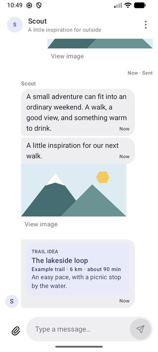
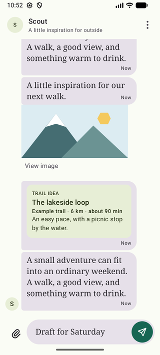
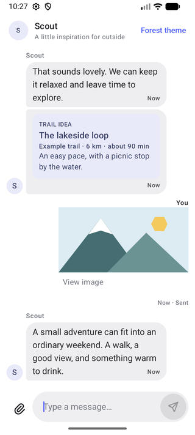
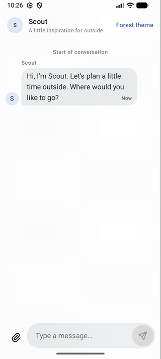

<div align="center">

# Compose Chat

### A conversation worth opening.

Chat UI for **Compose Multiplatform** — ready to use, easy to make your own.

**Android · iOS · Desktop JVM**

[Get started](#get-started) · [Customize](#make-it-your-own) · [Guides](docs/index.md) · [Sample](#try-it-yourself)

<p align="center">


</p>

**Your content. Your style.** Custom messages and themes in the same conversation.

*The Scout sample, running with local messages and bundled images.*

</div>

## Build the conversation. Keep your stack.

Add a message timeline and composer to your app without building every bubble, delivery indicator and scroll interaction yourself. Start with the Material 3 components, then adapt the colors, message content and controls to your product.

Your app supplies the messages and handles user events. Connect your own API, database or AI service through ordinary Kotlin callbacks.

- **A ready-made chat screen.** Grouped messages, sender details, send status, retry controls and a growing composer.
- **Reading that stays in place.** Load earlier messages without losing your position; jump back to the latest when you’re ready.
- **Room for your product.** Replace individual slots to show a booking, recommendation or another custom message.
- **Images and actions when you need them.** Add attachment presentation or copy, quote, edit and delete flows as separate modules.
- **One shared UI.** Compose targets for Android, arm64 iOS and desktop JVM.

## Get started

Add the Material 3 module to your shared module’s `commonMain` dependencies. Use `mavenCentral()` in your dependency repositories.

```toml
# gradle/libs.versions.toml
[versions]
chat = "0.0.1"

[libraries]
chat-material3 = { module = "dev.forntoh.chat:chat-material3", version.ref = "chat" }
```

```kotlin
// Your shared module's build.gradle.kts
kotlin {
    sourceSets.commonMain.dependencies {
        implementation(libs.chat.material3)
    }
}
```

`chat-material3` includes `chat-ui` and `chat-core`. Your shared module also needs its normal Compose and Material 3 dependencies for the composables it uses directly. Chat 0.0.1 uses Kotlin 2.4.0, Compose Multiplatform 1.11.1 and Material 3 1.11.0-alpha07.

### Create a working chat

Put this in your shared source set, then call `FirstChat()` from your app’s Compose content. It includes the state and handler: type a message, press Send, and it appears in the timeline.

```kotlin
import androidx.compose.material3.Text
import androidx.compose.runtime.Composable
import androidx.compose.runtime.getValue
import androidx.compose.runtime.mutableStateOf
import androidx.compose.runtime.remember
import androidx.compose.runtime.setValue
import dev.forntoh.chat.core.ConversationEvent
import dev.forntoh.chat.core.ConversationState
import dev.forntoh.chat.core.Delivery
import dev.forntoh.chat.core.Message
import dev.forntoh.chat.core.Participant
import dev.forntoh.chat.material3.ChatScaffold
import dev.forntoh.chat.material3.ChatTheme
import dev.forntoh.chat.ui.Conversation

@Composable
fun FirstChat() {
    val me = remember { Participant("me", "You") }
    var nextId by remember { mutableStateOf(1L) }
    var state by remember {
        mutableStateOf(
            ConversationState(
                conversationId = "weekend",
                currentParticipantId = me.id,
                messages = listOf(
                    Message(
                        id = "welcome",
                        sender = Participant("scout", "Scout"),
                        timestampEpochMillis = 0L,
                        displayTime = "Now",
                        text = "Where shall we go this weekend?",
                        delivery = Delivery.Sent,
                    ),
                ),
            ),
        )
    }

    val onEvent: (ConversationEvent) -> Unit = event@{ event ->
        if (event.conversationId != state.conversationId) return@event
        when (event) {
            is ConversationEvent.DraftChanged -> {
                state = state.copy(draft = state.draft.copy(text = event.text))
            }
            is ConversationEvent.SendDraft -> {
                val draft = state.draft
                if (draft.submitting || !draft.hasContent ||
                    event.revision != draft.revision ||
                    event.text != draft.text || event.attachments != draft.attachments
                ) return@event
                val row = Message(
                    id = "local-${nextId++}",
                    sender = me,
                    timestampEpochMillis = 0L,
                    displayTime = "Now",
                    text = event.text,
                    delivery = Delivery.Sent,
                    attachments = event.attachments,
                )
                state = state.copy(
                    messages = state.messages + row,
                    draft = draft.copy(
                        text = "",
                        attachments = emptyList(),
                        revision = draft.revision + 1,
                    ),
                )
            }
            is ConversationEvent.RetryMessage -> Unit
        }
    }

    ChatTheme {
        ChatScaffold(title = { Text("Weekend plans") }) {
            Conversation(state = state, onEvent = onEvent)
        }
    }
}
```

This local example accepts each send immediately. `remember` retains state while the screen stays mounted; use your ViewModel or another retained state holder for navigation and persistence. Replace the placeholder timestamps and `Now` labels with your app’s localized times.

### Connect your API or database

Keep the same `Conversation(state, onEvent)` call when you move the handler into your application layer.

| Event or update | What your application does |
| --- | --- |
| `DraftChanged` | Replace `draft.text`, preserving the rest of the draft. |
| `SendDraft` | Validate the conversation, draft revision, text and attachments against current state. Accept or refuse that exact submission. |
| Accepted send | Insert a stable message ID with `Delivery.Sending`; clear the accepted draft and increment its revision. Launch service work in your retained coroutine scope. |
| Refused send | Retain the draft content and increment its revision to unlock the composer. |
| Service result | Update the same row to `Sent` or `Failed`; recheck the conversation and request identity before applying asynchronous results. |
| `RetryMessage` | Retry the existing outgoing failed row, keeping its ID. |

Supply immutable snapshots with unique message IDs in display order, oldest first. Your host owns deduplication, persistence, cancellation and permissions; enforce access in your backend as well. `Draft.submitting` represents unresolved acceptance, independently of message delivery. See [Integration](docs/integration.md) for the full state contract.

## Make it your own

Change the palette, replace one control, or render a completely different message. All of these use the same conversation state and callbacks.

### Colors and typography

Wrap your screen in `ChatTheme`. It accepts an ordinary Material 3 color scheme and typography:

```kotlin
import androidx.compose.material3.Text
import androidx.compose.material3.Typography
import androidx.compose.runtime.Composable
import androidx.compose.ui.graphics.Color
import dev.forntoh.chat.core.ConversationEvent
import dev.forntoh.chat.core.ConversationState
import dev.forntoh.chat.material3.ChatScaffold
import dev.forntoh.chat.material3.ChatTheme
import dev.forntoh.chat.material3.chatColorScheme
import dev.forntoh.chat.ui.Conversation

@Composable
fun BrandedChat(state: ConversationState, onEvent: (ConversationEvent) -> Unit) {
    ChatTheme(
        colorScheme = chatColorScheme().copy(
            primary = Color(0xFF356859),
            onPrimary = Color.White,
            primaryContainer = Color(0xFFD6EDDF),
            onPrimaryContainer = Color(0xFF153C2F),
        ),
        typography = Typography(),
    ) {
        ChatScaffold(title = { Text("Weekend plans") }) {
            Conversation(state = state, onEvent = onEvent)
        }
    }
}
```

Use `chatColorScheme(darkTheme = true)` for the dark palette, or pass your existing design system’s colors and typography. Keep the conversation mounted when changing themes so its draft and reading position survive.


*The sample’s Forest palette demonstrates theme customization; it also customizes the header and message content.*

### Your own message content

Use `messageBody` to put a recommendation, booking or product card inside the existing bubble. Keep domain data in your app, keyed by message ID. Copy the current slots to retain defaults for ordinary messages:

```kotlin
import androidx.compose.foundation.layout.Column
import androidx.compose.material3.Text
import androidx.compose.runtime.Composable
import dev.forntoh.chat.core.ConversationEvent
import dev.forntoh.chat.core.ConversationState
import dev.forntoh.chat.ui.Conversation
import dev.forntoh.chat.ui.LocalConversationSlots

@Composable
fun RecommendationsChat(
    state: ConversationState,
    onEvent: (ConversationEvent) -> Unit,
    recommendations: Map<String, String>,
) {
    val defaults = LocalConversationSlots.current
    val slots = defaults.copy(
        messageBody = { message ->
            val recommendation = recommendations[message.id]
            if (recommendation == null) {
                defaults.messageBody(message)
            } else {
                Column {
                    Text("RECOMMENDED FOR YOU")
                    Text(recommendation)
                }
            }
        },
    )
    Conversation(state = state, onEvent = onEvent, slots = slots)
}
```

Call `RecommendationsChat` inside `ChatTheme` and `ChatScaffold`, in place of the plain `Conversation` call. Populate `recommendations` with IDs from `state.messages`. The bubble, sender/time and delivery presentation stay in place.


*Scout uses this same slot for a richer trail card. See the complete [TrailCard and message-body wiring](sample/src/commonMain/kotlin/dev/chat/sample/SampleApp.kt). The smaller example above renders a heading and recommendation text.*

If the visible content differs from `Message.text`, also supply `messageDescription` with an accurate accessible summary, including sender, content, time and delivery. Give interactive controls their own labels.

### Replace one control, keep the composer

This changes Send into a labeled Material button, retaining the field, draft and guarded submission callback:

```kotlin
import androidx.compose.material3.Button
import androidx.compose.material3.Text
import androidx.compose.runtime.Composable
import dev.forntoh.chat.core.ConversationEvent
import dev.forntoh.chat.core.ConversationState
import dev.forntoh.chat.ui.Conversation
import dev.forntoh.chat.ui.LocalConversationSlots

@Composable
fun CustomSendChat(state: ConversationState, onEvent: (ConversationEvent) -> Unit) {
    val defaults = LocalConversationSlots.current
    Conversation(
        state = state,
        onEvent = onEvent,
        slots = defaults.copy(
            composerSend = { content ->
                Button(onClick = content.onSend, enabled = content.canSend) {
                    Text(if (content.pending) "Sending…" else "Send message")
                }
            },
        ),
    )
}
```

Call this inside `ChatTheme` and your screen shell. To replace the entire input area, use the `composer` slot or `composerContent` argument. Render the supplied `ComposerContent.draft`, forward `onTextChange` and `onSend`, and respect `pending` and `canSend`. Use `onDraftAction` for attachment mutations. Custom fields should honor `focusRequest` in an effect when nonzero. Keep one shared draft throughout.

### Every conversation slot

Read `LocalConversationSlots.current` **inside** `ChatTheme`, then pass `defaults.copy(...)` to `Conversation(slots = ...)`. You can also set defaults across screens with `ChatTheme(slots = chatConversationSlots().copy(...))`, or use `ConversationTheme` with your own design system and `chat-ui`.

| Slot | What you can change |
| --- | --- |
| `messageBody` | Content inside the bubble: text, cards, rich domain content. |
| `messageMetadata` | Sender and time presentation. |
| `messageDelivery` | Sending, sent and failed indicators. |
| `messageAvatar` | Per-message avatar presentation; your app loads the image. |
| `messageSpacing` | Spacing based on the message’s group context. |
| `messageDescription` | Accessible summary of a message. |
| `retry` | The failed-message Retry control, using its supplied callback. |
| `message` | The whole message row; receives the message, outgoing flag and optional retry callback. |
| `presentedMessage` | A whole row with transient highlight/navigation context. Overrides `message` when set. |
| `composerField` | The editable field, using the shared composer content. |
| `composerSend` | Send control and pending presentation. |
| `composer` | The complete composer layout. |
| `history` | Earlier-history area, including empty-state context. |
| `historyFeedback` | Feedback inside the default history area: load, loading, error or exhausted. |
| `latest` | The return-to-latest control and its activation. |
| `latestLabel` | Just the label inside the default Latest control. |

A replacement controls its own rendering: if you replace a whole row or composer, call the smaller slots you still want to use. Forward supplied guarded callbacks on user activation, and provide appropriate focus and accessibility semantics.

Explicit `Conversation` renderer arguments (`messageContent`, `composerContent`, `historyContent`, `latestContent`) take precedence over the corresponding bundle slots; an explicit bundle takes precedence over theme defaults. `historyContent` receives `HistoryContent`, while the `history` slot receives `HistoryFeedbackContent` with empty-state context. See [ConversationSlots](chat/ui/src/commonMain/kotlin/dev/forntoh/chat/ui/ConversationSlots.kt) for all callback types.

### Customize the screen around the chat

`ChatScaffold` accepts `title`, `avatar`, `navigationIcon` and `actions` for its default header. Replace the whole header with `topBar`, and add `bottomBar`, `snackbarHost` or `floatingActionButton` as needed. These are ordinary composable lambdas; wire them to your own navigation and screen state.

You can also use your own shell: give `Conversation` a bounded height, such as `Modifier.weight(1f)` in a full-height column, and handle window insets. The [sample screen](sample/src/commonMain/kotlin/dev/chat/sample/SampleApp.kt) demonstrates a subtitle, avatar and overflow menu alongside a custom composer and message body.

## Images, actions and earlier messages

### Choose your modules

Start with Material 3, or select the foundation layer for your own design system. All modules use version **0.0.1**.

| Module | What it supplies |
| --- | --- |
| `chat-core` | Messages, participants, drafts, attachments and events without Compose UI. |
| `chat-ui` | Conversation behavior, scrolling, history and replaceable foundation renderers. Includes core. |
| `chat-material3` | Material 3 theme, bubbles, composer and scaffold. Includes UI and core. |
| `chat-media` | Optional attachment presentation, upload status and media intents. Depends on UI. |
| `chat-actions` | Optional copy, quote, edit and delete presentation and intents. Depends on UI. |

Add the optional modules to the same version catalog and `commonMain` dependencies:

```toml
[libraries]
chat-media = { module = "dev.forntoh.chat:chat-media", version.ref = "chat" }
chat-actions = { module = "dev.forntoh.chat:chat-actions", version.ref = "chat" }
```

```kotlin
implementation(libs.chat.media)
implementation(libs.chat.actions)
```

### Add image attachments

Your app supplies the picker, image renderer, upload and viewer. The module supplies the shared UI and user intents:

1. Retain a `MediaState` beside your conversation state. Put attachment descriptors in `Draft.attachments` and `Message.attachments`.
2. Obtain the adapter with `rememberMedia(conversation, mediaState, onRequest, onEvent)`; pass its `onConversationEvent` to `Conversation`.
3. Render `MediaAttachments(media, message, renderer)` alongside the text row, outside its merged message semantics. The renderer receives a `MediaTarget`; resolve its attachment’s opaque `contentReference` with your image loader.
4. Render `MediaDraft(media, content, renderer)` above the field. Pass `media.composer(content)` to your composer renderer so selection locks apply to both field and Send.
5. Handle `MediaRequest` commands `Select`, `Remove`, `Retry` and `View` in your host. Advance the media revision after resolution, including cancellation or denial; selection/removal also require a new draft revision. Recheck exact targets and permissions before applying asynchronous results.



*Both user and bot images use the same timeline. The sample supplies a local chooser and bundled image renderer.*

[Copy the complete sample wiring](sample/src/commonMain/kotlin/dev/chat/sample/SampleApp.kt), then replace its chooser and renderer with your adapters. [The media guide](docs/features.md#image-attachments) explains loading, progress, failure and resource identity.

### Add message actions

Retain `ActionState` with capabilities keyed by message ID. Create the adapter with `rememberMessageActions(conversation, actionState, onAction, onEvent)` and route events through its `onConversationEvent`. Render `MessageActions(adapter, message.id)` alongside each row and `ActionComposerStatus(adapter)` above the input. Pass `adapter.composer(content)` to the composer renderer.

The host handles clipboard access, quoted sends, edits and confirmed deletion, rechecking permissions and request revisions. Advance action revisions after each transition and draft revisions after resolving submissions or restoring drafts. When combining media and actions, chain their event adapters and preserve the same draft and its attachments. See [Message actions](docs/features.md#message-actions).

The optional modules have their own replaceable slots, independent of Material 3:

| Bundle | Slots |
| --- | --- |
| `MediaSlots` via `MediaTheme` | `control` for buttons; `feedback` for image status; `description` for accessible image text; `selectionError` for picker errors. |
| `ActionSlots` via `ActionTheme` | `control`, `status`, `quote`, plus `menu`, `composerStatus` and `confirmation` containers. Containers render their supplied child content once. |

Derive copies from `LocalMediaSlots.current` or `LocalActionSlots.current` to retain other defaults; explicit component slots take precedence over module themes. `MediaTheme` also accepts a text style, and `ActionTheme` accepts `ActionStyle` for typography, backgrounds, shapes and spacing. Custom controls honor their supplied enabled state and guarded activation callback.

### Load earlier history

History is off by default. Supply a retained `HistoryState` and handler to enable it:

```kotlin
import androidx.compose.runtime.Composable
import dev.forntoh.chat.core.ConversationEvent
import dev.forntoh.chat.core.ConversationState
import dev.forntoh.chat.ui.Conversation
import dev.forntoh.chat.ui.HistoryRequest
import dev.forntoh.chat.ui.HistoryState

@Composable
fun PagedChat(
    state: ConversationState,
    onEvent: (ConversationEvent) -> Unit,
    history: HistoryState,
    onLoadEarlier: (HistoryRequest) -> Unit,
) {
    Conversation(
        state = state,
        onEvent = onEvent,
        history = history,
        onLoadEarlier = onLoadEarlier,
    )
}
```

Start with `HistoryStatus.Idle` when an earlier page exists. Publish `Loading` before requesting it; merge overlapping IDs in your host, prepend the results and increment the history revision. Publish `Idle` if more pages exist, `Exhausted` at the end, or `Error` on failure. Retry follows explicit user activation.

Prepending retains the visible message and offset. New messages follow a reader already at the bottom; someone reading earlier messages gets a Latest control. Send and Latest return to following. For initial hydration and empty-page handling, see [Earlier history](docs/features.md#earlier-history).

## Try it yourself

From this repository, with JDK 21 and Android SDK 37 configured:

```sh
./gradlew :sample:run
```

Meet Scout: send a message, attach the bundled mountain illustration, or switch to Forest from the overflow menu. The bot shares a short burst of text, images and trail ideas, then waits. No service credentials are needed.



[Sample setup for desktop, Android and iOS →](docs/sample.md)

## Find your next step

| I want to… | Read |
| --- | --- |
| Get a working screen | [Getting started](docs/getting-started.md) |
| Connect my data and choose dependencies | [Integration](docs/integration.md) |
| Change the theme or render custom messages | [Customization](docs/customization.md) |
| Add images, message actions or earlier history | [Features](docs/features.md) |
| Run the project or contribute | [Sample](docs/sample.md) · [Contributing](CONTRIBUTING.md) |

## License

[Apache 2.0](LICENSE). See [third-party notices](NOTICE) for the icons used by the Material 3 components.
