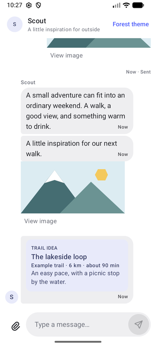

# Themes, slots and custom content

Presentation changes should keep the same `Conversation` mounted. Its draft, pending guards and reading position then survive a palette or slot change. Keep state in the host rather than copying it into a renderer.

`ChatTheme` accepts a color scheme, typography and slot bundle. Start from the reference bundle and replace only what you need:

```kotlin
import androidx.compose.material3.Text
import androidx.compose.runtime.Composable
import dev.forntoh.chat.core.ConversationEvent
import dev.forntoh.chat.core.ConversationState
import dev.forntoh.chat.material3.ChatTheme
import dev.forntoh.chat.material3.chatConversationSlots
import dev.forntoh.chat.ui.Conversation

@Composable
fun CardChat(state: ConversationState, onEvent: (ConversationEvent) -> Unit, cards: Map<String, String>) {
    val defaults = chatConversationSlots()
    val slots = defaults.copy(messageBody = { message ->
        val card = cards[message.id]
        if (card == null) defaults.messageBody(message) else Text(card)
    })
    ChatTheme(slots = slots) {
        Conversation(state, onEvent)
    }
}
```

The sample follows this pattern with a host-owned `TrailSuggestion` map keyed by message identity. Its body slot renders a small route card. Custom data is a host concern; the library does not parse special text or prescribe a schema for every content type.



Slot precedence is explicit renderer argument, explicit slot bundle, ambient theme, then foundation defaults. `presentedMessage` supplies transient highlight/navigation context and takes precedence over `message`; an explicit `messageContent` still wins. Keep controls and their semantics separate from a message's combined sender/body/time/delivery description.

A custom composer forwards `ComposerContent.onTextChange`, `onSend` and guarded `onDraftAction`. Honor `pending` and `canSend`; do not retain callbacks after their rendered snapshot changes. Expose labels, focus and accessibility semantics in your content. `focusRequest` can request input focus after an explicit Reply.

`ChatScaffold` exposes title, avatar, navigation, actions and an optional replacement top bar. Empty navigation/actions create no inactive controls. Keep native window insets at the host boundary. The shared timeline measures the overlay composer so latest messages remain above it.
