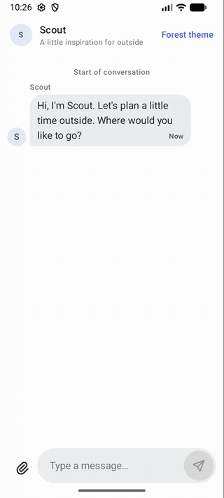

# Chat that belongs to your application

Compose Chat renders a conversation from immutable host snapshots. It keeps the timeline, composer guards and reading-position behavior in one shared component. Your application decides who can access a conversation, stores its data, and calls its services.

Start with [a small conversation](getting-started.md), then [select the modules](modules.md) you need. Material3 provides a ready-made theme and screen shell. Foundation slots support custom presentation, including host-defined cards. Optional actions and images add guarded UI without adding a transport or platform picker.

The [offline sample](sample.md) shows these boundaries in one chat with Scout. For platform floors and verification limits, read [support](support.md). Contributors can run the same [quality and documentation commands](development.md) as CI.
