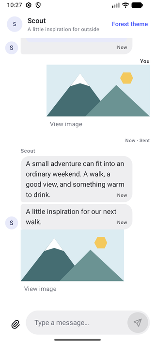
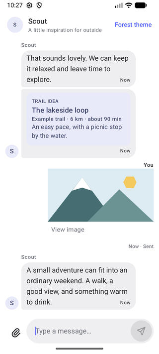

# Host-supplied images

Select `chat-media` alongside `chat-ui`, plus Material3 only if you want its default conversation appearance. The module provides guarded attachment intents and presentation, while your host owns resource lookup, permission checks, selection, uploading and the viewer.

An `Attachment` has a stable ID, declared media type, opaque content reference and optional accessible description. Core/UI never open that reference. Replace the descriptor when a resource changes, so captured targets cannot address new content through an old identity.

Retain `MediaState` beside the conversation and create its adapter with `rememberMedia(conversation, mediaState, onRequest, onEvent)`. In your existing Conversation slots:

- Render `MediaAttachments(content, message, renderer)` after the message body, outside its merged message semantics.
- Adapt the existing composer with `content.composer(composer)`. Render `MediaDraft` in its header.
- Request selection through `content.request(MediaCommand.Select, composer = adapted)`. This forwards the shared draft-action guard.

For image-only messages, the sample composes the image with sender and time metadata through the public row slot.

The sample's `SampleApp.kt` is a complete working integration using public slots and a bundled renderer. It displays bot and user images in the same conversation. Tapping an image opens a host-owned dialog; attaching presents one bundled choice. No OS picker, network or upload account is required.

A request binds the media revision and exact `MediaTarget`: conversation plus draft/message snapshot and attachment descriptor. Validate those values and current permission before starting work and when it completes. Advance media revision on resolution. Selection/removal also advance draft revision, including cancellation or denial, to release the shared latch.

Report loading, upload progress, failure, missing and unsupported resources through `ImageState`. Absent state means Ready, not confirmed delivery. A failed upload offers Retry on the same target. Do not mark a row Sent until its upload succeeds. A renderer's load error must become Missing for the exact current target rather than throw during composition.

The bundled fixture is an original vector illustration under this repository's Apache-2.0 license. Real picker, permission and upload integration remain host work; fixture success does not verify those services.
