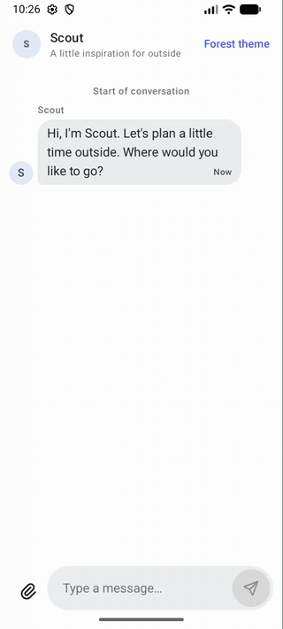
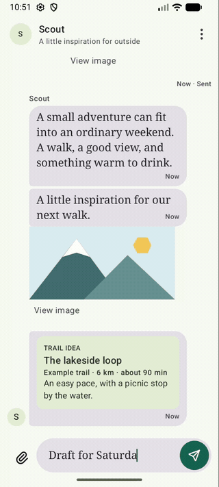
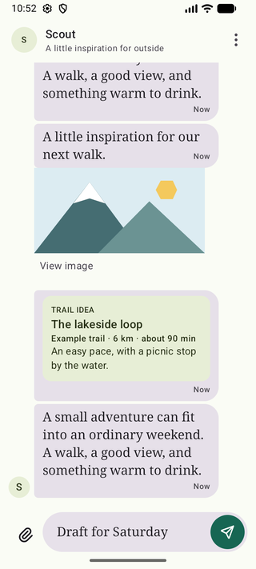

# Run the offline bot sample

Scout replies after a short delay when you send text. Independently, it occasionally shares text, the bundled mountain illustration and a custom trail card. The toolbar overflow offers default/forest themes and Pause bot / Resume bot; the composer keeps Send and image attachment. Both participants' images open in a simple viewer.



The host uses a seedable scheduler (seed 42 by default), 0.9–1.8 second replies and 15–30 second autonomous intervals. Each burst contains at most three arrivals, then Scout stays idle until an accepted user message or explicit resume. Pause cancels pending arrivals and replies immediately; you can still send messages while paused. Resume starts one fresh burst without replaying missed messages. Disposal/reset cancels all queued work. The scheduler starts once per mounted session. Theme changes retain the same host and Conversation. Reset is a host/test seam, not an ordinary screen control. All messages and drafts are in memory.

Pause and resume from the overflow without replacing the conversation or draft:



The forest theme keeps the same conversation and draft:



## Tools

Use JDK 21 to launch Gradle and supply the compilation toolchain. The committed daemon criteria separately select JDK 25, using an installed/cached JDK or provisioning it on the first run. Android projects also require `ANDROID_HOME` pointing to an SDK with API 37. The wrapper pins Gradle 9.4.1; Kotlin is 2.4.0, Compose 1.11.1 and AGP 9.1.0. See [support](support.md) for platform limits.

## Desktop

```sh
./gradlew :sample:run
```

## Android

```sh
./gradlew :androidApp:assembleDebug
adb install -r androidApp/build/outputs/apk/debug/androidApp-debug.apk
adb shell am start -n dev.chat.sample.android/.MainActivity
```

Choose a device with `adb -s SERIAL` if more than one is connected. The Android host retains its BotHost in a ViewModel.

## iOS simulator

Install full Xcode and XcodeGen, select Xcode (or set `DEVELOPER_DIR`), then generate and build the existing host:

```sh
cd iosApp
xcodegen generate
xcodebuild -project ChatSample.xcodeproj -scheme ChatSample \
  -sdk iphonesimulator -configuration Debug \
  -destination 'generic/platform=iOS Simulator' CODE_SIGNING_ALLOWED=NO build
```

The generated project invokes the shared framework task. Select a concrete simulator in Xcode to run it. Physical-device signing is separate host setup. Software-keyboard overlap and real picker/upload behavior remain unverified.

## Fixtures

The normal screen uses one bot conversation. Contract checks supply manual action/history snapshots and media outcomes through public APIs in test sources; they do not ship another application route.

`sample/src/commonMain/composeResources/drawable/mountain.xml` is an original local fixture licensed under Apache-2.0. It is rendered by the host, never fetched from a network.
